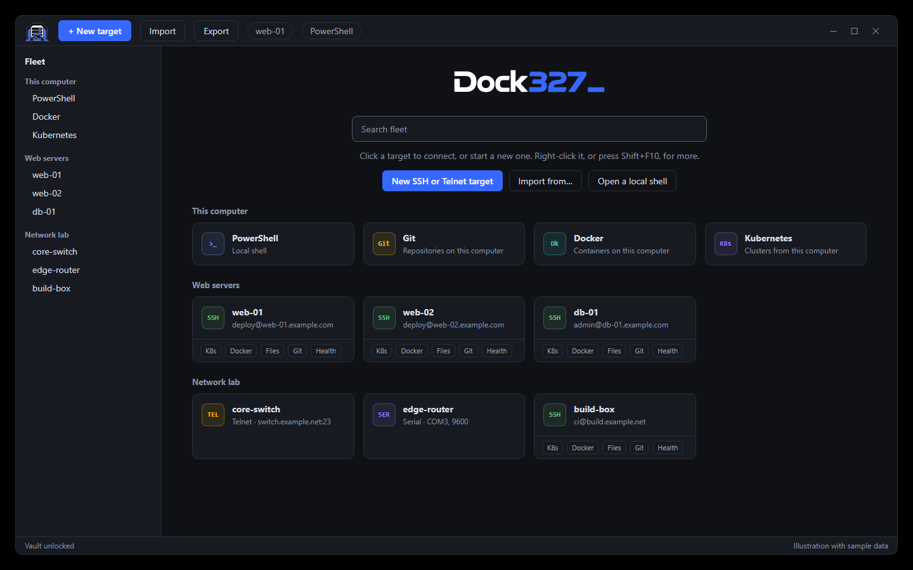

<p align="center">
  <picture>
    <source media="(prefers-color-scheme: dark)" srcset="assets/logo-dark.svg">
    
  </picture>
</p>

<p align="center">
  <b>Terminal and SSH client for network and systems engineers,<br>with Docker, Kubernetes and Git tools.</b>
</p>

<p align="center">
  
  
</p>

<p align="center">
  
  <br>
  <sub>Mock-up with sample data. The app may look different.</sub>
</p>

This is the place to report bugs and suggest ideas. It holds no source code.

## <picture><source media="(prefers-color-scheme: dark)" srcset="assets/h-what-dark.svg"></picture>

| | |
|---|---|
| **Connect** | Local shell, SSH, Telnet and serial consoles |
| **Work side by side** | Tabs, split panes and broadcast typing |
| **Keep secrets safe** | Encrypted vault for passwords and key passphrases, with Windows Hello unlock |
| **Move files** | SFTP file browser in a pane |
| **Run containers** | Docker, Kubernetes and Redis browsers |
| **Track code** | Git panel |

## <picture><source media="(prefers-color-scheme: dark)" srcset="assets/h-before-dark.svg"></picture>

> [!WARNING]
> **Use test servers only.** This is unreleased software.

> [!IMPORTANT]
> **Every test build stops working on 18 February 2027 (00:00 UTC).**
> Export your saved sessions before then, using **Export targets…** in the toolbar.

## <picture><source media="(prefers-color-scheme: dark)" srcset="assets/h-install-dark.svg"></picture>

1. Get the Windows installer from the person who invited you. Don't pass it on.
2. Check that its hash matches the one they sent you:
   ```powershell
   Get-FileHash .\Dock327_0.1.0_x64-setup.exe
   ```
3. Run it. The installer is not signed yet, so Windows warns you. Continue only if the hash matched.

There is no automatic update.

## <picture><source media="(prefers-color-scheme: dark)" srcset="assets/h-bug-dark.svg"></picture>

Search the **Issues** tab first. If it is new, open an issue with:

| Include | Example |
|---|---|
| Installer name and the date you got it | `Dock327_0.1.0_x64-setup.exe`, 1 December |
| Operating system | Windows 11 |
| Steps | 1. Open an SSH session 2. Split right 3. … |
| What you expected | The new pane connects |
| What happened | The pane stays blank |
| How bad it is | Crash or data loss / blocks my work / annoying / cosmetic |

> [!CAUTION]
> **Remove passwords, keys, tokens, server names, user names and IP addresses**
> from text, logs and screenshots before you post. Other testers can read your report.

## <picture><source media="(prefers-color-scheme: dark)" srcset="assets/h-idea-dark.svg"></picture>

Open an issue and say what you were trying to do, how you do it today and how often it comes up.
The problem is more useful to us than the design.

## <picture><source media="(prefers-color-scheme: dark)" srcset="assets/h-security-dark.svg"></picture>

**Never open an issue for a security problem.**
Send it privately to the person who invited you, and wait for a reply before telling anyone else.
